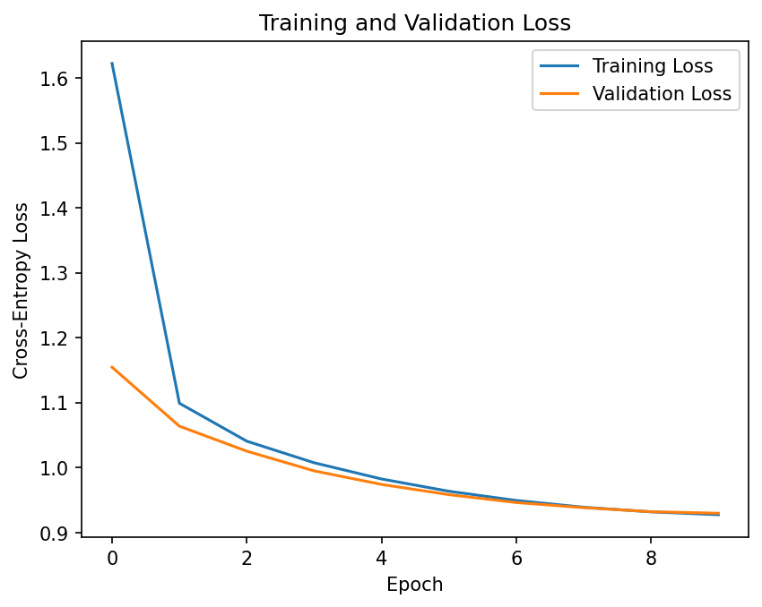

# Task 1 GPT-Style LLM Results

## Overview

A character-level GPT-style language model was implemented from scratch and trained on the TinyStories dataset for autoregressive next-character prediction. The model uses manually implemented multi-head causal self-attention.

The final run used 100,000 TinyStories for training and 10,000 for validation. The best checkpoint was obtained at epoch 10.

## Data preprocessing

The Hugging Face TinyStories dataset was loaded from the shared local dataset folder. For this individual run, only the original TinyStories training split was used to create the model's train and validation subsets. The original training split was shuffled with seed `4253`; the first 100,000 stories were selected for training and the next 10,000 stories for validation.

The stories in each subset were concatenated with newline separators and tokenized at the character level. The character vocabulary was constructed from the training text only.

| Setting | Value |
|---|---:|
| Training stories | 100,000 |
| Validation stories | 10,000 |
| Vocabulary size | 152 characters |
| Training characters | 89,734,384 |
| Validation characters | 8,964,594 |
| Unseen validation characters | 0 |
| Sequence length | 128 |
| Training sequences | 701,049 |
| Validation sequences | 70,035 |

Each training example contains 128 input characters, and its target is the same sequence shifted forward by one character. This produces fixed-length input-target pairs for autoregressive next-character prediction.

## Architecture

The model is a compact decoder-only GPT architecture with two Transformer decoder blocks. All self-attention operations, causal masking, head splitting/merging, and residual connections were implemented directly rather than through a prebuilt Transformer or attention module.

- Token embedding: learned `nn.Embedding`, vocabulary size 152, embedding dimension 128
- Positional embedding: learned `nn.Embedding`, maximum sequence length 128
- Decoder blocks: 2
- Hidden dimension (`d_model`): 128
- Attention heads: 4
- Dimension per head: 32
- Attention: manually implemented scaled dot-product multi-head self-attention
- Causal masking: upper-triangular future-token mask applied before softmax
- Block layout: Pre-LayerNorm self-attention + residual, then Pre-LayerNorm feed-forward network + residual
- Feed-forward network: `128 -> 512 -> 128` with GELU activation
- Final normalization: LayerNorm
- Language-model head: linear projection from 128 hidden units to 152 vocabulary logits
- Total parameters: 452,248

The GPT had learned token and positional embeddings, causal multi-head self-attention, feed-forward layers, residual connections, normalization, and a next-token language-model head. Four heads divide the 128-dimensional hidden representation evenly into 32 dimensions per head.

## Training configuration

| Setting | Value |
|---|---|
| Random seed | 4253 |
| Epochs | 10 |
| Batch size | 32 |
| Optimizer | Adam |
| Loss | Cross-entropy |
| Base learning rate | 0.0003 |
| Total training steps | 219,080 |
| Warm-up | First 5% of steps |
| Warm-up steps | 10,954 |
| LR schedule after warm-up | Cosine decay |
| Minimum LR ratio | 0.1 of base LR |
| Final LR floor | 0.00003 |

I used a compact configuration with 2 Transformer decoder blocks, a model
dimension of 128, 4 attention heads, a sequence length of 128 and run for 10 epochs.
This configuration was informed by prior coursework experience with a
similar model that trained stably. I kept the model relatively small to
maintain stable and manageable training within the available compute and
time budget. The learning-rate schedule uses linear warm-up for the first 5% of optimization steps and cosine decay afterward to 10% of the base learning rate. This satisfies the required warm-up and scheduling component while reducing the learning rate later in training.

## Training behavior

Training and validation loss both decreased throughout all 10 epochs. Validation loss improved at every epoch, so the final epoch was also the best checkpoint.

| Metric | Epoch 1 | Epoch 10 |
|---|---:|---:|
| Logged training loss | 1.6223 | 0.9274 |
| Validation loss | 1.1545 | 0.9296 |
| Average gradient norm | 0.8783 | 0.8886 |
| Maximum gradient norm | 2.9612 | 1.2422 |
| Training tokens/sec | 571,592 | 573,516 |

The final metrics below were recomputed after reloading the best checkpoint and evaluating over the full training and validation loaders. Therefore, the reported full-training cross-entropy (`0.925289`) is slightly different from the epoch-10 logged training loss (`0.927362`).

No non-finite loss or gradient values were observed during training. The mean gradient norm across epoch averages was `0.84709`, the maximum recorded gradient norm was `2.9612`, and the non-finite training-step count was `0`.

Loss-curve evidence:

## Evaluation metrics

| Metric | Value |
|---|---:|
| Training cross-entropy loss | 0.925289 |
| Validation cross-entropy loss | 0.929594 |
| Training perplexity | 2.522596 |
| Validation perplexity | 2.533480 |
| Training bits-per-character | 1.334909 |
| Validation bits-per-character | 1.341121 |
| Generalization gap (val CE - train CE) | 0.004305 |
| Training top-1 next-character accuracy | 0.707259 |
| Validation top-1 next-character accuracy | 0.706133 |
| Distinct-1 | 0.531915 |
| Distinct-2 | 0.901099 |
| Distinct-3 | 0.974432 |
| Repeated 4-gram rate | 0.000000 |
| Mean gradient norm | 0.84709 |
| Maximum gradient norm | 2.9612 |
| Non-finite training steps | 0 |
| Parameter count | 452,248 |
| Training throughput | 572,170 character tokens/s |
| Generation throughput | 585.99 character tokens/s |
| Peak GPU memory | 123.55 MB |
| Total training time | 1,614.17 s (26.90 min) |

The validation metrics are close to the training metrics. The cross-entropy generalization gap is only `0.004305`, and validation top-1 accuracy `0.706133` is close to training accuracy `0.707259`. Under these metrics, there is little separation between training and validation performance at the selected checkpoint. Distinct-1 is moderate at 0.532, while Distinct-2 and Distinct-3 are high at 0.901 and 0.974. This suggests that although individual words are reused, the model produces relatively diverse multi-word sequences.

## Text generation

Temperature-based sampling was used for generation.

| Setting | Value |
|---|---|
| Prompt | `One day` |
| New characters per sample | 150 |
| Temperatures | 0.5, 0.8, 1.0 |
| Samples per temperature | 4 |
| Total samples | 12 |
| Total generated characters | 1,800 |
| Overall generation speed | 585.99 character tokens/s |

The diversity metrics were calculated over the generated continuations using word-level n-grams. Distinct-1/2/3 were `0.531915`, `0.901099`, and `0.974432`, while the repeated 4-gram rate was `0.0`.

For text generation, I evaluated temperatures of 0.5, 0.8, and 1.0.
The lower temperature provides more conservative generation, while the
three temperature settings make it possible to observe how generation
behavior changes as sampling becomes less constrained.

The samples show that the model learned recognizable TinyStories-style patterns such as simple names, family terms, animals, dialogue, and phrases such as "One day" and "From that day on." However, generation quality is still limited by broken grammar, weak semantic coherence, and malformed or invented words. For example, lower-temperature samples contain phrases such as "the store was the truck," while temperature `1.0` produces malformed words such as "pencing," "advimmering," and "trumpy." The higher-temperature samples therefore show more randomness but also more obvious character-level errors.

Generation evidence:

- `task1_llm/jiayi/outputs/generation_samples.txt`
- `task1_llm/jiayi/outputs/generation_samples.json`

## Efficiency and hardware

| Metric | Value |
|---|---:|
| Training GPU | NVIDIA A100-SXM4-40GB |
| Python | 3.13.15 |
| PyTorch | 2.11.0+cu128 |
| CUDA | 12.8 |
| Peak GPU memory | 123.55 MB |
| Total training time | 1,614.17 s (26.90 min) |
| Training throughput | 572,170 character tokens/s |
| Generation throughput | 585.99 character tokens/s |

## Observations & shortcomings

1. Training was stable across all 10 epochs. Training and validation losses decreased steadily, gradient norms remained finite, and no NaN/Inf training steps were recorded.
2. The final train and validation metrics are very close. The validation cross-entropy was `0.929594` versus `0.925289` on training data, producing a small generalization gap of `0.004305`.
3. Next-character prediction accuracy reached about 70.6% on validation data, showing that the model learned substantial character-level structure from TinyStories.
4. The n-gram diversity metrics show little exact phrase repetition in the short generated samples, including a repeated 4-gram rate of `0.0`. However, this does not imply strong story quality: manual inspection still shows grammar errors and loss of coherence.
5. Generation quality worsens noticeably at temperature `1.0`, where malformed words and less coherent phrases appear more often. Lower-temperature samples are generally more locally recognizable but still contain grammatical and semantic errors.
6. The main limitation is generation quality rather than numerical training instability. A 2-layer, 452K-parameter character model can learn local TinyStories patterns, but its short context and small capacity still produce weak long-range coherence and malformed text.

## Evidence and reproducibility

Run ID: `20261001_000337`

Best checkpoint:

`task1_llm/jiayi/checkpoints/task1_gpt_best_20261001_000337.pt`

Best epoch: `10`

Config:

`task1_llm/jiayi/config.json`

Raw training log:

`reproducibility/raw_logs/task1_jiayi_train_20261001_000337.log`

Training manifest:

`reproducibility/manifests/task1_jiayi_manifest_20261001_000337.json`

Environment manifest:

`reproducibility/manifests/task1_jiayi_environment_20261001_000337.txt`

Metrics:

`task1_llm/jiayi/metrics_report.csv`

Generation outputs:

- `task1_llm/jiayi/outputs/generation_samples.txt`
- `task1_llm/jiayi/outputs/generation_samples.json`

Loss curve:

`task1_llm/jiayi/outputs/loss_curve_20261001_000337.png`
