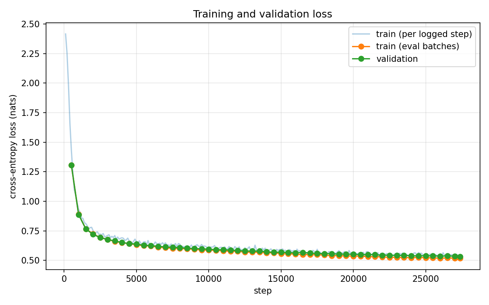
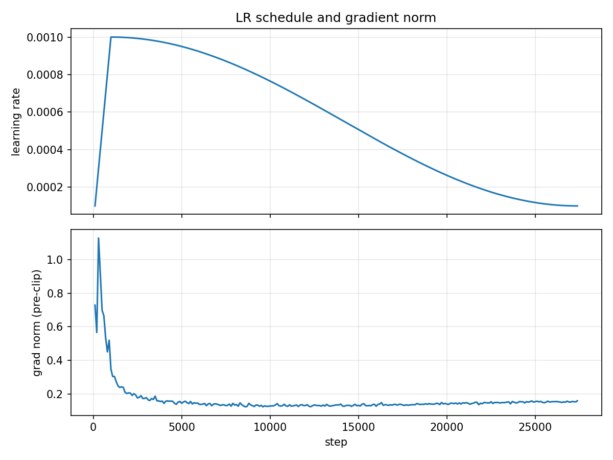

# Task 1: GPT-style character language model (kruthika)

A decoder-only Transformer built from scratch in PyTorch and trained on TinyStories to predict the next character. No prebuilt Transformer or attention modules are used: attention, causal masking and the blocks are written by hand in [`src/model.py`](src/model.py).

| | |
|---|---|
| Run | `gpt_L6_H6_D384` |
| Checkpoint | `checkpoints/gpt_L6_H6_D384_best.pt` (SHA-256 `3560d0be…a221c`) |
| Raw log | `reproducibility/raw_logs/task1_kruthika_gpt_L6_H6_D384_20260929-024039.log` |
| Manifest | `reproducibility/manifests/task1_kruthika_gpt_L6_H6_D384_20260929-024039.json` |
| Notebook (with outputs) | [`src/task1_colab.ipynb`](src/task1_colab.ipynb) |
| Config | [`src/config.yaml`](src/config.yaml) |
| Hardware | Google Colab GPU; the exact model, Python 3.13.15 and PyTorch 2.11.0 are recorded in the manifest and `metrics_report.csv` |

---

## 1. Data preprocessing (Task 1.1) — [`src/data.py`](src/data.py)

| Step | What was done | Why |
|---|---|---|
| Source | `roneneldan/TinyStories` from Hugging Face, pinned revision | Same data for every run and team member |
| Cleaning | Repaired broken encodings (e.g. `“` → `"`; about 39K occurrences in 120K stories), then kept printable ASCII plus newlines; empty entries dropped | Otherwise the model wastes capacity learning garbage characters; the vocabulary shrinks from 111 to 89 |
| Split | **10,000 validation** stories from the official `validation` split; **100,000 training** stories from the official `train` split; random with seed 1337 | Validation text comes from a separate source |
| Leakage check | The `train` split contains **6,601 exact copies** of `validation` stories. Any training story identical to a chosen validation story is skipped (overlap after filtering: **0**) | Validation loss must measure performance on unseen text |
| Vocabulary | `char_to_idx` / `idx_to_char` over every training character plus an end-of-story marker `§` → **89 characters** | Character-level tokenization, as the brief requires |
| Encoding | Stories joined with `§` into one sequence: **89.7M** training and **8.7M** validation characters | The `§` marker lets the model learn where a story ends |
| Sequences | Random fixed-length windows: input `x` = 256 characters, target `y` = the same window shifted one character to the right | Every position predicts the next character (autoregressive language modelling) |

## 2. Model (Task 1.2) — [`src/model.py`](src/model.py)

```
characters (B, 256)
  → token embedding (89 → 384) + learned position embedding (256 → 384)
  → 6 × Transformer block:
        x = x + MultiHeadCausalSelfAttention(LayerNorm(x))   # 6 heads × 64 dims
        x = x + FeedForward(LayerNorm(x))                     # 384 → 1536 → 384, GELU
  → final LayerNorm → LM head (384 → 89) → logits
```

- **Multi-head self-attention:** queries, keys and values come from one linear layer. Scores are `QKᵀ / √64`; after softmax, the weights average the values. The heads are concatenated and projected back.
- **Causal mask:** a lower-triangular matrix sets the scores of future positions to `-inf`, so they get zero weight after softmax. A test confirmed that changing a character at position *t* does not change any prediction before *t*.
- **Pre-LayerNorm and residual connections:** gives gradients a direct path through the stack, so deep Transformers train stably.
- **Initialization:** weights ~ N(0, 0.02), biases zero. The starting loss (4.24) matched random guessing, ln(vocab size) (4.23), as expected.
- **Parameters:** **10,814,297**.

## 3. Training (Task 1.3) — [`src/train.py`](src/train.py)

| Hyperparameter | Value | Why |
|---|---|---|
| Layers / heads / width | 6 / 6 / 384 | ~10.8M parameters: enough capacity for fluent stories, still trains in minutes on one GPU |
| Context (`block_size`) | 256 characters | About 2–3 sentences; attention cost grows with the square of this length |
| Batch size | 128 sequences (32,768 characters per step) | Stable gradient estimates; fits comfortably in GPU memory (5.3 GB peak) |
| Epochs | 10 (2,738 steps each, 27,380 total, 897M characters seen) | Brief minimum; 1 epoch = as many sampled characters as the training set holds |
| Optimizer | AdamW, β = (0.9, 0.95), weight decay 0.1 on weight matrices only | Standard for Transformers; decaying biases or LayerNorm weights does not help |
| Learning rate | Linear warm-up from 0 to **1e-3** over 1,000 steps, then cosine decay to **1e-4** | Warm-up avoids unstable early updates; cosine decay fine-tunes as training ends |
| Gradient clipping | global norm 1.0 | Protection against loss spikes |
| Dropout | 0.1 | Light regularization |
| Loss | Cross-entropy over every position | Brief requirement |
| Precision | bf16 mixed precision, with `torch.compile` | Faster training on the GPU |
| Model selection | Checkpoint with the lowest validation loss (evaluated every 500 steps) | The best was the final step, 27,380 |

**Loss curves:** the loss falls quickly in the first ~2K steps, then decreases slowly and smoothly. The validation curve stays on top of the training curve for the whole run: no overfitting.





## 4. Results — all Task 1 metrics ([`metrics_report.csv`](metrics_report.csv))

Final metrics use the best checkpoint. Validation metrics cover the **entire** 10K-story validation set (non-overlapping 256-character windows); training metrics use an equal-sized slice of the training set.

| Metric | Value |
|---|---|
| Training cross-entropy loss | 0.518 |
| Validation cross-entropy loss | **0.536** |
| Perplexity (validation) | **1.71** |
| Bits-per-character (validation) | **0.773** |
| Generalization gap (val − train loss) | 0.017 |
| Top-1 next-character accuracy (train / val) | 83.3% / **82.8%** |
| Distinct-1 / 2 / 3 (word level, T = 0.8 samples) | 0.274 / 0.672 / 0.854 |
| Repeated 4-gram rate (T = 0.8 / greedy) | 0.19% / 8.3% |
| Gradient norm, mean / max (before clipping) | 0.165 / 1.13 |
| Loss spikes / NaN or inf steps | 0 / 0 |
| Parameter count | 10,814,297 |
| Training throughput | ~947K characters/s |
| Generation throughput | ~220 characters/s (batch 1, no KV cache) |
| Peak GPU memory | 5.28 GB |
| Total training time | 15.8 min |

**How the metrics were computed**
- **Perplexity** = e^(validation loss).
- **Bits-per-character** = validation loss / ln 2.
- **Top-1 accuracy:** the share of positions where the highest-scoring character equals the true next character.
- **Distinct-n:** unique word n-grams ÷ total word n-grams, over all 20 temperature samples.
- **Repeated 4-gram rate:** the share of word 4-grams inside a sample that already appeared earlier in the same sample.
- **Throughput:** measured with GPU synchronization; evaluation time is excluded from training time.

### Sample (T = 0.8)

> Once upon a time, there was a little boy named Timmy. He loved to play with his toys all day long. One day, his mom asked him to go to the store to buy treats. Timmy was so excited to go to the store that he put his toy car away in the backyard.

All 25 samples are in [`outputs/gpt_L6_H6_D384/samples.txt`](outputs/gpt_L6_H6_D384/samples.txt).

## 5. Observations

- **Strengths:** near-perfect spelling and grammar, correct punctuation and dialogue formatting, typical story structure ("Once upon a time…", "The end." followed by `§`), and a very small generalization gap.
- **Weaknesses:** meaning drifts over longer spans. Characters change identity, new names appear from nowhere, facts contradict earlier ones, and greedy decoding falls into loops. See [`failure_analysis.md`](failure_analysis.md).
- **Limitation:** 256 characters is only about 50 words of memory, so details from earlier in a story are forgotten.
- **Next steps:** a longer context window (512), subword tokens so the same window covers more text, or a larger model. The small gap suggests the model is not yet overfitting, so more capacity should help.
