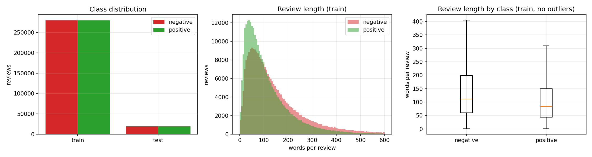
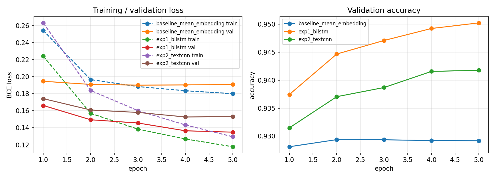
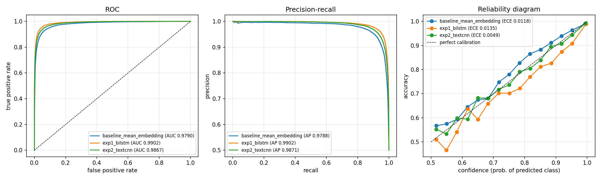

# Task 2: Yelp Polarity sentiment classification (kruthika)

Three binary sentiment classifiers trained from scratch in PyTorch. **No pretrained embeddings or language models:** every model learns its own 128-dimensional word embeddings.

| | |
|---|---|
| Raw log | `reproducibility/raw_logs/task2_kruthika_sentiment_20261002-031643.log` |
| Manifest | `reproducibility/manifests/task2_kruthika_sentiment_20261002-031643.json` (config, environment, checkpoint SHA-256s, metrics) |
| Notebook (with outputs) | [`src/task2_colab.ipynb`](src/task2_colab.ipynb) |
| Config | [`src/config.yaml`](src/config.yaml) |
| Checkpoints | `checkpoints/baseline_mean_embedding_best.pt`, `checkpoints/exp1_bilstm_best.pt`, `checkpoints/exp2_textcnn_best.pt` |
| Hardware (all 3 models) | Google Colab GPU; the exact model, Python 3.13.15 and PyTorch 2.11.0 are recorded in the log, manifest and `metrics_report.csv` (`device` row) |

---

## 1. Data analysis and preprocessing (Task 2.1) — [`src/data.py`](src/data.py)

**Dataset:** `fancyzhx/yelp_polarity` (pinned revision): 560,000 training and 38,000 test reviews. Labels: 0 = negative (1–2 stars), 1 = positive (3–4 stars).

**Class balance:** perfectly balanced, 280,000 / 280,000 in train and 19,000 / 19,000 in test. No resampling or class weights are needed, and accuracy, macro-F1 and micro-F1 are almost identical.

**Review length:** mean 133 words, median 97, 95th percentile 372, max 1,052. Negative reviews are longer than positive ones (median 112 vs 84 words, mean 152 vs 115): people explain complaints in more detail.

**Missing and malformed entries** ([`outputs/eda/eda_stats.json`](outputs/eda/eda_stats.json)):

| Check | Result | Handling |
|---|---|---|
| Missing or empty reviews | 0 (train), 0 (test) | none needed |
| Duplicate reviews in train | 0 | none needed |
| Test reviews also in train | 0 | no leakage |
| Literal `\n` sequences stored as text | 269,718 train reviews (48%) | replaced with a space *before* removing punctuation; otherwise "`\nThe`" would become the fake word "nthe" |
| HTML entities (`&amp;`, …) | 27 train reviews | removed |
| Reviews empty after preprocessing | 46 (train), 0 (test) | encoded as a single `<unk>` token so every review has length ≥ 1 |

**Preprocessing steps:**

| Step | Choice | Why |
|---|---|---|
| Lowercasing | yes | "Great" and "great" mean the same thing |
| Negation contractions | "didn't" → "did not", "can't" → "can not" | keeps the negation as a separate word |
| Punctuation, digits, special characters | removed | brief requirement; reduces the vocabulary |
| Stopword removal | NLTK English list (195 words removed), **keeping 10 negations** (not, no, never, nor, none, nothing, nobody, nowhere, neither, cannot) | the standard list would turn "not good" into "good" and flip the sentiment |
| Stemming | Porter stemmer ("loved"/"loving" → "love") | merges word forms; vocabulary 40,159 |
| Tokenization | whitespace split after cleaning | — |
| Vocabulary | words seen 5+ times in the **training split only**; `<pad>` = 0, `<unk>` = 1 | no information from validation/test; unknown-word rate is only 0.49% on test |
| Length | max 256 tokens (mean 69, median 50, 95th percentile 191); 2.0% of reviews truncated | covers about 98% of reviews in full; shorter batches are trimmed to their longest review |
| Split | 504,000 train / 56,000 validation (stratified 90/10 of the official train split, seed 42); **official 38,000 test set** for all reported metrics | validation for early stopping; the test set is touched only once |

## 2. Models (Task 2.2) — [`src/models.py`](src/models.py)

All three models share the same preprocessing, vocabulary, 128-dim embedding layer (learned from scratch, ~5.1M of each model's parameters), loss (binary cross-entropy), optimizer (Adam), batch size 256, gradient clipping 1.0, and early stopping on validation loss (max 5 epochs, patience 2; best epoch restored).

| | Baseline: `baseline_mean_embedding` | Experimental 1: `exp1_bilstm` | Experimental 2: `exp2_textcnn` |
|---|---|---|---|
| Idea | Bag of words: average all word embeddings → linear layer | Read the review in both directions with an LSTM; pool over time | Detect local phrases with convolution filters |
| Architecture | Embedding(40,159 × 128) → masked mean → dropout 0.3 → Linear(128 → 1) | Embedding → dropout 0.3 → 1-layer **BiLSTM** (128 per direction, packed sequences) → [max-pool ; mean-pool] (512) → dropout 0.3 → Linear(512 → 1) | Embedding → Conv1d with **3-, 4- and 5-word filters** (128 each) → ReLU → max over time (384) → dropout 0.5 → Linear(384 → 1) |
| Learning rate | 2e-3 (simple model, converges fast) | 1e-3 | 1e-3 |
| Parameters | 5,140,481 | 5,405,057 | 5,337,729 |
| Why this model | Simple, fast reference point: how far does word choice alone get us? | Word order and context matter for sentiment ("not … good", "but"); the bidirectional LSTM sees words on both sides. Max-pooling picks the strongest signal, mean-pooling the overall tone | Sentiment is often carried by short phrases ("not worth it", "highly recommend"); a CNN finds them anywhere in the review and is much faster than an LSTM |

The three models have roughly the **same parameter count**, so the comparison isolates the architecture rather than model size.

## 3. Training

| Model | Epochs run | Best epoch (val loss) | Best val accuracy | Training time | Training speed |
|---|---|---|---|---|---|
| Baseline | 5 | 3 (0.190) | 92.94% | 25 s | 99,000 examples/s |
| BiLSTM | 5 | **5** (0.135) | 95.03% | 7.7 min | 5,500 examples/s |
| TextCNN | 5 | 4 (0.153) | 94.16% | 53 s | 47,500 examples/s |

- **Baseline:** validation loss stops improving after epoch 2–3. A bag of words has limited capacity.
- **BiLSTM:** validation loss was *still decreasing* at epoch 5, so more epochs would probably help.
- **TextCNN:** validation loss flattens at epochs 4–5 while training loss keeps falling, an early sign of overfitting.
- No NaN or unstable losses in any run.

## 4. Results on the test set (38,000 reviews) — [`metrics_report.csv`](metrics_report.csv)

| Metric | Baseline | **BiLSTM** | TextCNN |
|---|---|---|---|
| Accuracy | 0.9326 | **0.9531** | 0.9435 |
| 95% CI (accuracy) | [0.9301, 0.9352] | **[0.9509, 0.9550]** | [0.9412, 0.9456] |
| Precision (macro / micro / weighted) | 0.9326 / 0.9326 / 0.9326 | **0.9531 / 0.9531 / 0.9531** | 0.9436 / 0.9435 / 0.9436 |
| Recall (macro / micro / weighted) | 0.9326 / 0.9326 / 0.9326 | **0.9531 / 0.9531 / 0.9531** | 0.9435 / 0.9435 / 0.9435 |
| F1 (macro / micro / weighted) | 0.9326 / 0.9326 / 0.9326 | **0.9531 / 0.9531 / 0.9531** | 0.9435 / 0.9435 / 0.9435 |
| 95% CI (macro-F1) | [0.9301, 0.9352] | **[0.9509, 0.9550]** | [0.9412, 0.9456] |
| Confusion matrix (TN / FP / FN / TP) | 17,799 / 1,201 / 1,360 / 17,640 | 18,059 / **941** / **841** / 18,159 | 17,852 / 1,148 / 998 / 18,002 |
| ROC-AUC | 0.9790 | **0.9902** | 0.9867 |
| PR-AUC | 0.9788 | **0.9902** | 0.9871 |
| MCC | 0.8652 | **0.9062** | 0.8871 |
| 95% CI (MCC) | [0.8602, 0.8703] | **[0.9019, 0.9101]** | [0.8825, 0.8913] |
| Brier score (lower = better) | 0.0517 | **0.0359** | 0.0424 |
| ECE, 15 bins (lower = better) | 0.0118 | 0.0135 | **0.0049** |
| Parameters | 5,140,481 | 5,405,057 | 5,337,729 |
| Training time | **25 s** | 460 s | 53 s |
| Training examples/s | **98,985** | 5,481 | 47,450 |
| Inference examples/s | **1,187,092** | 62,306 | 203,973 |
| Peak GPU memory | **965 MB** | 1,471 MB | 1,224 MB |

Confusion matrix plots: [baseline](outputs/baseline_mean_embedding/confusion_matrix.png) · [BiLSTM](outputs/exp1_bilstm/confusion_matrix.png) · [TextCNN](outputs/exp2_textcnn/confusion_matrix.png)

### Paired McNemar test (baseline vs each experimental model, same 38,000 reviews) — [`outputs/mcnemar.csv`](outputs/mcnemar.csv)

| Comparison | Baseline right, exp. wrong (b) | Baseline wrong, exp. right (c) | χ² (continuity corrected) | p-value |
|---|---|---|---|---|
| Baseline vs BiLSTM | 588 | 1,367 | 309.6 | 2.7 × 10⁻⁶⁹ |
| Baseline vs TextCNN | 677 | 1,092 | 96.9 | 7.3 × 10⁻²³ |

Both experimental models are **significantly better** than the baseline. The 95% confidence intervals of the three models do not overlap either.

### Robustness: macro-F1 and error rate per data slice — [`outputs/slice_metrics.csv`](outputs/slice_metrics.csv)

| Slice | n | % positive | Baseline: error / macro-F1 | BiLSTM: error / macro-F1 | TextCNN: error / macro-F1 |
|---|---|---|---|---|---|
| Short (≤ 50 words) | 9,362 | 59.9% | 6.87% / 0.9285 | 5.30% / 0.9448 | 6.04% / 0.9370 |
| Medium (51–200) | 21,172 | 49.9% | 6.77% / 0.9323 | 4.53% / 0.9547 | 5.46% / 0.9454 |
| Long (> 200) | 7,466 | 37.9% | 6.50% / 0.9305 | 4.38% / 0.9535 | 5.71% / 0.9394 |
| Has negation | 28,177 | 41.1% | 7.25% / 0.9249 | 4.81% / 0.9504 | 5.77% / 0.9404 |
| No negation | 9,823 | 75.6% | 5.28% / 0.9274 | 4.35% / 0.9407 | 5.28% / 0.9272 |
| Has contrast word (but/however/although/though/yet) | 22,075 | 45.1% | 7.51% / 0.9241 | 5.11% / 0.9484 | 6.13% / 0.9382 |
| No contrast word | 15,925 | 56.9% | 5.68% / 0.9422 | 4.10% / 0.9582 | 4.98% / 0.9492 |

The slices are **not class-balanced**: long reviews and reviews with negations are mostly negative, and short reviews and reviews without negations mostly positive. So error rate and macro-F1 can disagree. For example, the BiLSTM's *no negation* slice has a lower error rate (4.35%) but also a lower macro-F1 (0.9407): its few negative reviews (24%) are harder for the model, and macro-F1 weights both classes equally.

## 5. Comparative analysis (Task 2.3)

**Strengths**
- **The BiLSTM is the best model on every quality metric:** accuracy, F1, MCC, ROC-AUC, PR-AUC and Brier. Compared with the baseline it cuts errors by 30% (2,561 → 1,782), and it is the most robust in every slice.
- **The BiLSTM gains most where word order matters.** Its advantage over the baseline is largest on reviews with negations (7.25% → 4.81% error, −2.4 points) and contrast words (7.51% → 5.11%, −2.4 points). Without them the gain is smaller (5.28% → 4.35%, −0.9 points). A bag of words cannot tell "good, but…" from "not good"; a sequence model can.
- **The TextCNN is a good middle ground:** 94.4% accuracy at ~9× the BiLSTM's training speed, and the **best calibrated** model (ECE 0.0049). Its predicted probabilities are the most trustworthy.
- **The baseline is fast and reasonable:** 93.3% from word choice alone, trained in 25 s, with over 1M predictions per second.

**Weaknesses and limitations**
- The **BiLSTM is the slowest** (18× slower to train than the baseline, 19× slower at inference) and slightly **overconfident**: its reliability curve sits below the diagonal at confidence 0.6–0.95.
- **All models struggle with the same review types:** mixed or contrastive reviews, sarcasm, short reviews and lukewarm 3-star reviews (labelled positive in this dataset). See the [manual error review](failure_analysis.md).
- **Preprocessing throws away useful signal.** The standard stopword list removes "but", "very", "more", "if" and "now"; removing punctuation and digits deletes emoticons (`:(`) and explicit ratings ("5 stars"). Several of the 20 reviewed errors trace back to this.
- **Training budget:** the BiLSTM was still improving at epoch 5, so its result is probably not its maximum. Each model was trained once (one seed), so seed-to-seed variance is not measured.
- **Label noise** (text and rating disagree) limits the achievable accuracy.

**Future work**
1. **Lighter preprocessing for the neural models:** keep contrast, intensity and conditional words, map emoticons and "N stars" to tokens. Compare the contrast and short slices.
2. **More epochs for the BiLSTM** (e.g. 10, with a learning-rate schedule) and a 2-layer or attention-pooling variant.
3. **Word bigrams** for the baseline (fastText-style) to capture "not good", "can't get enough".
4. **Temperature scaling** on the validation set to fix the BiLSTM's overconfidence.
5. **Several seeds per model**, to report mean ± standard deviation.
