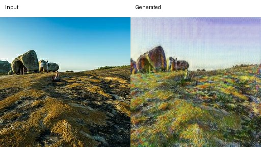
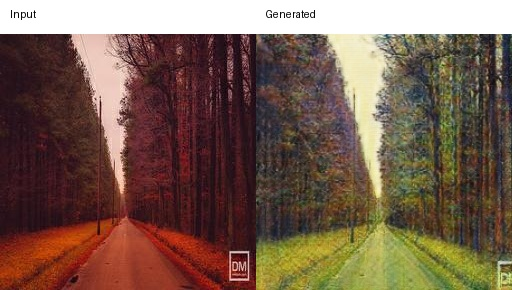

# Task 3 Failure Analysis

## Failure Case 1: Monet → Photo remains painterly

Observation:
The generated image still looks visible paint-like and some areas becomes even more blur. The overall image does not resemble an photo.

Possible reason:
The generator may preserve too much source domain texture while maintaining content.

## Failure Case 2: Photo → Monet loses fine structure

Observation:
There are style transfers, but some details such as two people are simplified and can not be recognized.

Possible reason:
The generator prioritizes target domain texture over details, since the same details does not present in every source domain data.

## Failure Case 3: Color or texture artifacts

Observation:
The generated image has the same road and forest structure, but the color just changes.

Possible reason:
The generator may learn that a strong color prior from the training images and apply it too aggressively. 

## Overall failure patterns
Across the evaluated samples:
A2B tended to preserve content better but most of the generated images still look like painting.
B2A shows stronger Monet-style transfer but details becomes simplified.
