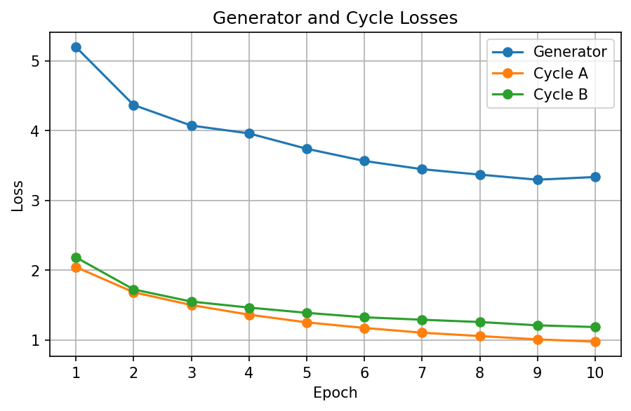
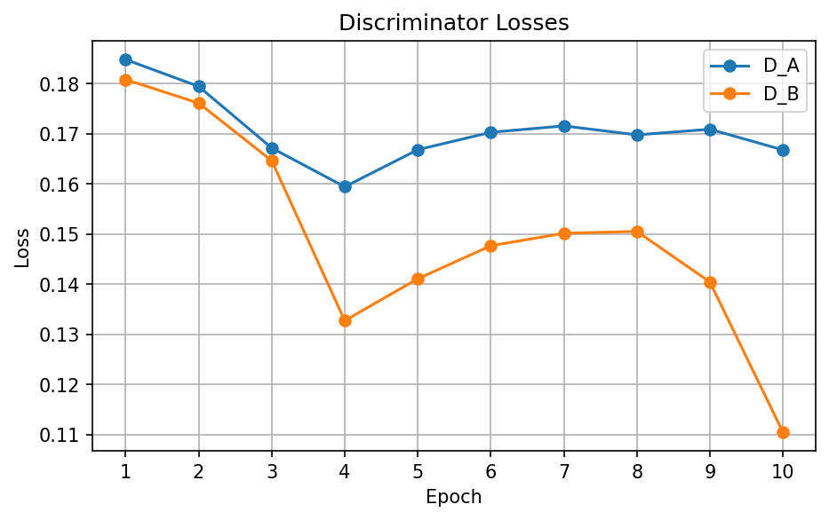
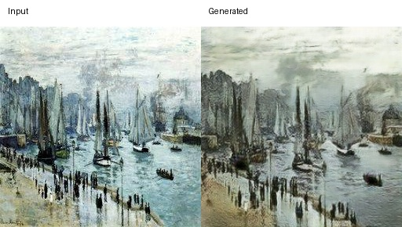
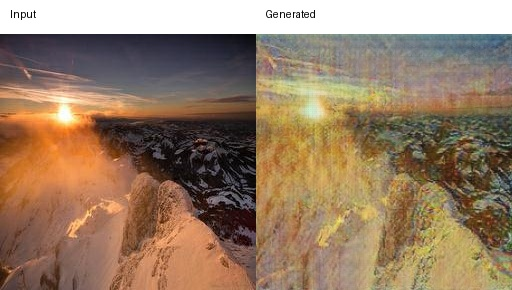

# Task 3 CycleGAN Results

## Overview

A CycleGAN was trained for unpaired translation between Domain A Monet-style paintings and Domain B real-world photos. The implementation used two generators and two discriminators.

### Architecture

- Generator architecture: ResNet generator with 6 residual blocks
- Discriminator architecture: basic 3-layer PatchGAN (70 x 70 patch classifier)
- Input channels: 3
- Output channels: 3
- Generator base filters (`ngf`): 64
- Discriminator base filters (`ndf`): 64
- Normalization: Instance Normalization
- Dropout: disabled
- Weight initialization: normal, gain = 0.02
- Total generator parameters: 15,675,398
- Total discriminator parameters: 5,529,474
- Total parameters: 21,204,872

## Data augmentation

The run used 300 Monet images and 7038 photos. The dataset is unpaired. The original images were 256 x 256 pixels. 
During training, each image was first resized to 286 x 286
The data is first resized to 286. Then they are random cropped to 256 x 256. Random horizontal flip is also applied. After converting to tensor, 
normalization is applied to each RGB channel with mean 0.5 and std 0.5.

Inference used deterministic resize + center crop to 256 x 256, followed by the same normalization.

## Training configuration

| Setting | Value |
|---|---|
| Epochs | 10 |
| Batch size | 2 |
| Optimizer | Adam |
| Learning rate | 0.0001 |
| Adam betas | (0.5, 0.999) |
| GAN objective | LSGAN |
| Cycle loss | L1 |
| `lambda_A` | 10 |
| `lambda_B` | 10 |
| Identity loss | Not used |
| `lambda_identity` | 0 |
| Learning-rate scheduler | None |
| Image pool | Disabled |
| Random seed | 4253 |

Identity loss was not used and lambda_identity = 0. Therefore, the identity loss contribution to the generator objective was 0. The generator objective combined the two adversarial losses and the two weighted cycle-consistency losses.

The architecture follows the general CycleGAN design with ResNet generators, PatchGAN discriminators, Instance Normalization, adversarial loss, and cycle-consistency loss. I used a 6-block ResNet generator and trained for 10 epochs as a smaller experimental configuration. A learning rate of 0.0001 was used for conservative adversarial updates.

## Training Behavior

Training was stable across all 10 epochs. Generator and cycle losses generally decreased
The losses had not clearly plateaued by the final epoch, so full convergence was not clearly reached within 10 epochs.

Selected training values:

| Metric | Epoch 1 | Epoch 10 |
|---|---:|---:|
| Generator loss | 5.1999 | 3.3377 |
| `D_A` loss | 0.1848 | 0.1668 |
| `D_B` loss | 0.1809 | 0.1104 |
| Weighted cycle loss A | 2.0480 | 0.9787 |
| Weighted cycle loss B | 2.1866 | 1.1875 |

Stability statistics:

| Metric | Value |
|---|---:|
| Mean generator gradient norm | 39.6356 |
| Mean discriminator gradient norm | 11.7017 |
| Loss NaN count | 0 |
| Sampled gradient NaN count | 0 |

The sampled generator and discriminator gradient norms remained finite, no NaN losses were observed, and no NaN gradients were detected in the sampled gradient checks.

Loss-curve 

## Evaluation

### Visual Quality
For Monet-to-Photo, the generated images still look quite painterly. Most of the scene structure and objects are preserved, 
but the model mainly changes the color and contrast rather than making the images looks like a photo. 
For Photo-to-Monet, the style transfer is much stronger. The generated images looks like paintings and have softer details, while the main objects are still recognizable. However, some images also show visible texture artifacts and loss of fine detail.

Example Monet → Photo:

Example Photo → Monet:

### Distribution and generation metrics

| Metric | Monet→Photo (A2B) | Photo→Monet (B2A) |
|---|---:|---:|
| FID | 107.5787 | 108.7093 |
| MiFID | 0.4237 | 0.4099 |
| KID | 0.02210 | 0.01240 |
| Generative precision | 0.6200 | 0.3467 |
| Generative recall | 0.3067 | 0.6533 |

The FID values were similar between directions. B2A had lower KID and MiFID. A2B had higher precision and lower recall, whereas B2A had lower precision and higher recall.

### Content preservation and cycle reconstruction

| Metric | Monet→Photo (A2B) | Photo→Monet (B2A) |
|---|---:|---:|
| LPIPS | 0.3775 | 0.4370 |
| Content cosine similarity | 0.8022 | 0.7624 |

Cycle reconstruction:

| Cycle | L1 distance |
|---|---:|
| Monet→Photo→Monet | 0.09334 |
| Photo→Monet→Photo | 0.11393 |

A2B had lower LPIPS, higher content cosine similarity, and lower cycle-reconstruction L1, it means a stronger source content preservation under these metrics.
Cycle consistency was verified in both directions by translating an input to the opposite domain and then translating it back to the original domain. The reconstructed image was compared with the original input using L1 distance. The non-zero but relatively small reconstruction errors show that the cycle constraint was functioning in both directions.

## Human audit

A fixed 30 sample audit was completed with two raters with 15 Monet→Photo samples and 15 Photo→Monet samples. Ratings used 1–5 scores for style, content, and artifacts. Higher artifact scores representing fewer visible artifacts.

| Criterion | Monet→Photo | Photo→Monet |
|---|---:|---:|
| Style | 1.667 | 3.867 |
| Content | 3.500 | 3.833 |
| Artifacts | 3.000 | 3.267 |
| Mean | 2.722 | 3.656 |

Overall human audit mean: 3.189 / 5

The Photo to Monet scores were higher than Monet to Photo across all three aspects. Monet to Photo had a reasonable content score but had weak target-style conversion.

Quadratic weighted Cohen's kappa:

| Criterion | Kappa |
|---|---:|
| Style | 0.8821 |
| Content | 0.3814 |
| Artifacts | 0.3571 |
| Mean across criteria | 0.5402 |

Agreement was strongest for style and lower for content and artifact judgments.

Human-audit evidence:
- task3_gan/jiayi/outputs/human_audit_ratings.csv
- task3_gan/jiayi/outputs/human_audit_samples.csv

## Efficiency and hardware

| Metric | Value |
|---|---:|
| Training time | 2415.55 s (40.26 min) |
| Training throughput | 58.27 images/s |
| Peak GPU memory | 2562.60 MB |
| Training GPU | NVIDIA A100-SXM4-40GB |
| Training CPU | Intel(R) Xeon(R) CPU @ 2.20GHz |

Environment recorded by the run:

- Python 3.13.15
- PyTorch 2.11.0+cu130
- CUDA 13.0

## Kaggle result

| Metric | Value |
|---|---:|
| Average FID | 108.14398 |
| Average MiFID | 0.41682 |
| Public leaderboard score | -48.3416 |
| Private leaderboard score | -54.2803|
| Public leaderboard rank | competition ongoing, current rank:18 as of 10/5/26 |

## Observations & shortcoming

1. Training was stable. Losses generally decreased, gradient statistics remained finite, and no NaNs were recorded.
2. Photo to Monet was visually stronger. Human style score was 3.867/5 compared with 1.667/5 for Monet to Photo.
3. Monet to Photo preserved content more strongly under automated metrics. It had lower LPIPS, higher content cosine similarity, and lower cycle-reconstruction L1.
4. The two directions showed different precision and recall behavior. A2B has higher precision, while B2A has higher recall.
5. The main limitation was direction-dependent output quality rather than numerical instability. The Monet to Photo direction in particular did not achieve convincing target-style conversion in the human audit.

## Evidence and reproducibility

Run ID: `20261004_021221`

Checkpoint:

task3_gan/jiayi/checkpoints/task3_cyclegan_final_20261004_021221.pt

Config:

task3_gan/jiayi/config.json

Raw training log:

reproducibility/raw_logs/task3_jiayi_cyclegan_train_20261004_021221.log

Training manifest:

reproducibility/manifests/task3_jiayi_cyclegan_manifest_20261004_021221.json

Evaluation manifest:

reproducibility/manifests/task3_jiayi_cyclegan_evaluation_20261004_021221.json

Full metrics:

task3_gan/jiayi/full_metrics_report.csv
