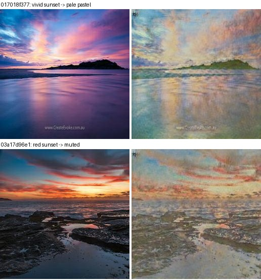
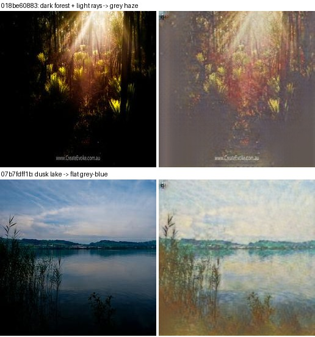
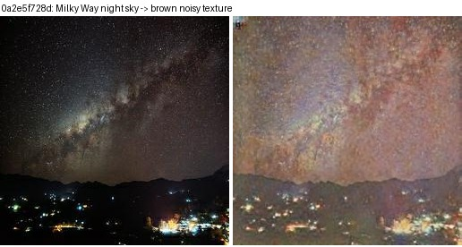
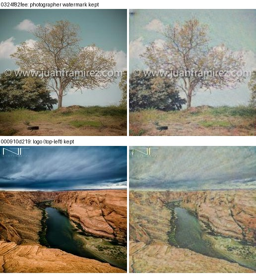
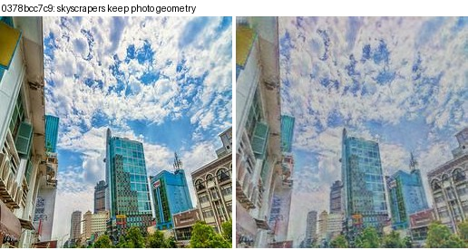
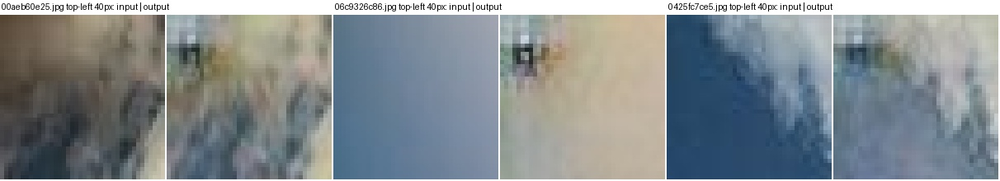
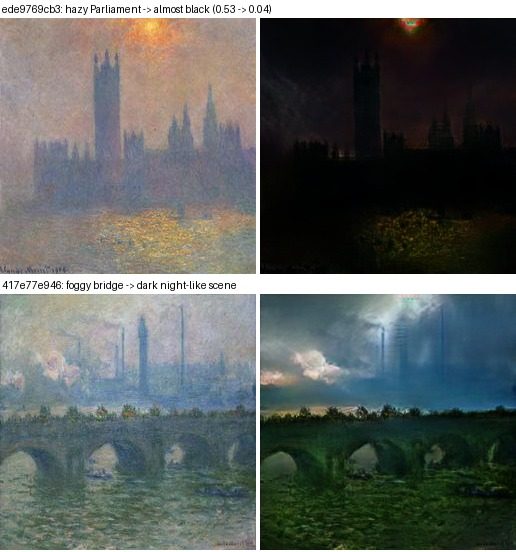
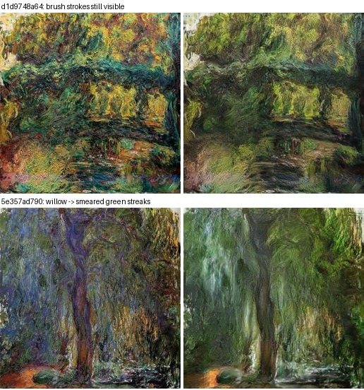

# Task 3: Visual quality and failure analysis (CycleGAN v2)

**Model:** `cyclegan_v2_ft`, the final submitted model (checkpoint `checkpoints/cyclegan_v2_ft_best.pt`, epoch 18, raw weights).
**Images reviewed:** the predictions in `outputs/pred_B2A/` (photo→Monet) and `outputs/pred_A2B/` (Monet→photo). The 300 photos the evaluation script scores (first 300 by file name) and all 300 Monets were checked by eye on contact sheets and measured with simple image statistics. Evidence images are in [`outputs/failure_cases/`](outputs/failure_cases/), each showing **input | output**.

---

## What works

- **Content is preserved.**
  - Scene layout, horizons, buildings and trees stay in place in both directions.
  - Cycle reconstruction is close to the original: L1 of 0.034 (photo→Monet→photo) and 0.031 (Monet→photo→Monet) on a 0–1 pixel scale.
  - Inception features of input and output have a cosine similarity of 0.81.
- **Photo→Monet works best on Monet's own subjects:** fields, trees, water, clouds and coastlines (e.g. `00aeb60e25`, `0425fc7ce5`, `0506726dbd`, `064b9119de`). These get a soft pastel palette and visible brush-stroke texture.
- **Monet→photo works best on clear, well-lit paintings:** fields, coastlines and gardens (e.g. `1814cc6632`, `2f90c99e10`, `b1310da865`). They become smooth, photo-like scenes with realistic sky gradients.
- **Coverage:** the generated Monets cover 99% of the real Monets' modes (k-NN coverage). The model translates every kind of photo into something Monet-like, rather than collapsing to a few styles.

## Failure cases

### 1. Washed-out palette on vivid scenes (photo→Monet)

- **Observation:** saturated sunsets and skies (`017018f377`, `03a17d96e1`) become pale pastels.
- **The numbers:** across the 300 scored outputs, mean saturation is **0.19 vs 0.30 for real Monets** and contrast **0.14 vs 0.18**. The variety between images (std of saturation) is **0.05 vs 0.13**. Very vivid photos (saturation 0.61) end up at only 0.23, *less* colourful than an average Monet. The generator squeezes all photos towards one muted palette.
- **Likely causes:**
  1. **DiffAugment's colour augmentation**, which randomly shifts brightness, saturation and contrast of everything the discriminator sees. This makes the discriminator partly blind to palette.
  2. **The identity loss**, which rewards outputs that stay close to their input.
- **This costs FID twice:** once for the wrong mean features, and once for the too-narrow spread.

### 2. Dark, high-contrast scenes turn into grey haze (photo→Monet)

- **Observation:** a dark forest with light rays (`018be60883`) and a dusk lake (`07b7fdff1b`) lose their deep shadows and become flat grey-blue.
- **Why:** real Monets are bright (mean brightness 0.58 vs 0.47 for photos) and rarely contain deep blacks. The generator lifts all shadows, which removes the scene's drama.

### 3. Night sky: out of distribution (photo→Monet)

- **Observation:** a Milky Way photo (`0a2e5f728d`) becomes a brown, noisy texture: the stars turn into speckle and the black sky turns brown.
- **Why:** there are **no night scenes** among the 300 Monet paintings, so the model has no target to imitate and produces a generic warm texture instead. This is a fundamental limit of a 300-image training domain.

### 4. Watermarks and logos are copied (photo→Monet)

- **Observation:** photographer watermarks (`0324f82fee`: "www.juanframirez.com"), logos (`000910d219`) and camera icons (`03a2b7ce83`) remain in the "paintings".
- **Why:** cycle consistency rewards keeping every detail needed to rebuild the photo, so overlays are kept rather than painted over. This is the expected trade-off of CycleGAN's content constraint.

### 5. Modern urban scenes stay photographic (photo→Monet)

- **Observation:** skyscrapers (`0378bcc7c9`) get Monet texture on the sky but keep sharp, photographic geometry.
- **Why:** Monet's subjects (gardens, water, 19th-century towns) contain no modern architecture, so the generator has no stylistic reference for it.
- **Effect on FID:** this **content mismatch** is part of why photo→Monet FID cannot reach the "real vs real" level. Inception features encode *what* is in the image, not only *how* it is painted.

### 6. Fixed artifact in the top-left corner (photo→Monet)

- **Observation:** every output has a small dark blob about 10 px from the top-left corner, at the **same position regardless of the input** (shown at 5× zoom).
- **The numbers:** the top-left 8×8 block differs from its neighbour **2.6× more** in outputs than in inputs (mean absolute difference 0.167 vs 0.064).
- **Why:** a fixed, input-independent mark is typical of CycleGAN hiding a small signal it uses for cycle reconstruction (*"CycleGAN, a master of steganography"*, Chu et al., 2017), or of border/padding effects in the encoder-decoder.
- **Effect:** visually minor, but it is a systematic defect in every submitted image.

### 7. Hazy, low-contrast Monets collapse to darkness (Monet→photo)

- **Observation:** Monet's foggy London scenes become very dark. *Houses of Parliament* (`ede9769cb3`) drops from brightness **0.53 to 0.04**, almost black, and the foggy bridge (`417e77e946`) turns into a dark night-like scene.
- **The numbers:** 33 of 300 outputs are more than 0.20 darker than their input, and 14 are darker than 0.20 overall. Mean brightness falls from 0.51 (paintings) to 0.42 (outputs; real photos average 0.47).
- **Why:** photos are darker and more contrasty than Monets. When the model meets a painting whose contrast comes from atmosphere rather than structure, it "explains" the haze as low light and pushes the whole image dark.

### 8. Brush strokes survive (Monet→photo)

- **Observation:** heavily textured paintings (`d1d9748a64`, the Japanese bridge; `5e357ad790`, willows) keep visible strokes or become smeared streaks instead of photographic detail.
- **Why:** strokes are strongly reinforced by the cycle loss (the Monet must be rebuildable from the photo), and the 70×70 PatchGAN cannot fully judge photo realism at larger scales.
- **The numbers:** generated photos have only **0.31 coverage** of the real-photo distribution. They resemble a narrow slice of photos (landscapes and water) and not the full variety of the photo set.

---

## Summary

| # | Failure | Direction | Root cause |
|---|---|---|---|
| 1 | Washed-out, uniform palette | photo→Monet | colour-randomising discriminator augmentation; identity loss |
| 2 | Dark scenes become grey haze | photo→Monet | Monet domain is bright; shadows lifted |
| 3 | Night sky → brown texture | photo→Monet | no night scenes in the 300 Monets (out of distribution) |
| 4 | Watermarks / logos kept | photo→Monet | cycle consistency preserves every detail |
| 5 | Modern buildings stay photographic | photo→Monet | content absent from Monet's work |
| 6 | Fixed top-left blob | photo→Monet | hidden reconstruction signal / border effect |
| 7 | Hazy paintings → dark | Monet→photo | haze misread as low light; photos are darker |
| 8 | Brush strokes remain | Monet→photo | cycle loss + local PatchGAN |

**Shortcomings of the analysis:** the visual review covers a sample of images (48 pairs on contact sheets plus targeted checks), not every output. The statistics (saturation, brightness, corner difference) cover all 300 scored images in each direction. The blinded human audit of 30 samples is reported separately in `results.md`.
