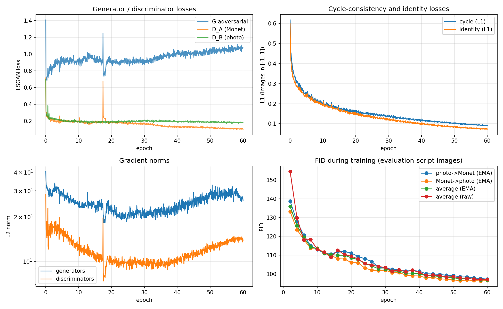
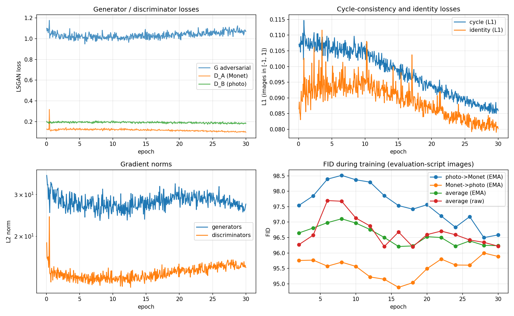

# Task 3: CycleGAN Monet ↔ Photo (kruthika)

An unpaired image-to-image translation model, a **CycleGAN written from scratch in PyTorch**: two ResNet generators and two PatchGAN discriminators, trained with adversarial, cycle-consistency and identity losses. Pretrained networks (Inception-v3, AlexNet) are used **only to measure** images (FID, KID, LPIPS), never to generate them. Every submitted image is the direct output of the trained generators: no editing, no selection of individual images.

| | |
|---|---|
| Final model | `cyclegan_v2_ft`: checkpoint `checkpoints/cyclegan_v2_ft_best.pt` (epoch 18 of the fine-tune, raw weights) |
| Kaggle | **−48.3416** (v2); v1 scored −48.6774. **Rank 19** on 2026-10-05 (17th when v1 was first submitted) |
| Submission | [`submission.csv`](submission.csv): `FID 96.2718, MiFID 0.4115` |
| All metrics | [`full_metrics_report.csv`](full_metrics_report.csv) (v1's in `outputs/cyclegan_v1/`) |
| Code | [`src/`](src/) (`models.py`, `data.py`, `train.py`, `metrics.py`), [`evaluate_local.py`](evaluate_local.py), configs [`config.yaml`](src/config.yaml) (v1) and [`config_v2.yaml`](src/config_v2.yaml) (v2) |
| Notebook (with outputs) | [`src/task3_colab.ipynb`](src/task3_colab.ipynb) |
| Raw logs / manifests | `reproducibility/raw_logs/task3_kruthika_cyclegan_v1_*`, `..._cyclegan_v2_ft_*` (training + evaluation, with checkpoint SHA-256s) |
| Predictions | `outputs/pred_A2B/` (300, Monet→photo), `outputs/pred_B2A/` (7,038, photo→Monet) |
| Hardware | Google Colab GPU; the exact model is recorded in the logs, manifests and `full_metrics_report.csv` (`device`) |

---

## 1. Data and scoring

- **Domains** (Kaggle class competition data):
  - **A = Monet paintings:** 300 images
  - **B = photos:** 7,038 images
  - All are 256×256 RGB JPG and **unpaired**.
- **Scoring** follows the instructor's evaluation script (`Part3_Evaluation_Script.ipynb`), which `evaluate_local.py` reproduces exactly:
  - **Inception-v3 features** (ImageNet weights, `transform_input=False`); images go through Resize(299) → CenterCrop → normalise.
  - **Only the first 300 files** (sorted by name) of each folder are used. Photo→Monet is compared with the 300 real Monets; Monet→photo with the first 300 real photos.
  - **FID** per direction, and **"MiFID"** = mean cosine distance between real[i] and generated[i] features, paired by index.
  - The submission reports the **average FID and average MiFID of both directions**. The leaderboard score is about −(FID + MiFID)/2.
- **Verification:**
  - The script's own code, run on the same folders, gave `FID 136.12102582858464, MiFID 0.44374629855155945`. Ours gave `136.1210257913046, 0.44374630714713825`.
  - Our local estimates matched Kaggle exactly for both submissions (v1 −48.6774, v2 −48.3416).
- **Note on environments:** recomputing v2's FID on a different machine (PyTorch 2.14 vs Colab's 2.11) gives 96.227 instead of 96.272. Image decoding and resizing differ very slightly between library versions; the submitted numbers come from the Colab run.

## 2. Architecture (Task 3.1) — [`src/models.py`](src/models.py)

| Component | Design | Parameters |
|---|---|---|
| Generators G_AB (Monet→photo), G_BA (photo→Monet) | ResNet encoder–decoder: 7×7 conv (64) → 2 stride-2 downsamplings (128, 256) → **9 residual blocks** at 64×64 → 2 transposed-conv upsamplings → 7×7 conv → tanh. Instance norm, reflection padding | 11,378,179 each |
| Discriminators D_A (Monet), D_B (photo) | **70×70 PatchGAN**: 4×4 convs 64→128→256→512 → 1-channel 30×30 map, each value judging one 70×70 patch. Instance norm, LeakyReLU 0.2 | 2,764,737 each |
| **Total** | | **28,285,832** |

**Why these choices:**
- **Residual blocks** keep the input's structure (x + F(x)), so the generator only has to learn the *change of style*.
- **The PatchGAN** judges local texture such as brush strokes rather than global layout. This suits style transfer and needs few parameters.
- **Instance normalisation** normalises each image separately, the standard choice for style transfer.

**Losses** (A = Monet, B = photo):
- **Adversarial (LSGAN, mean-squared error):** G_BA(photo) should be judged "real Monet" by D_A, and G_AB(Monet) "real photo" by D_B.
- **Cycle consistency, λ_cyc = 10:** |G_AB(G_BA(b)) − b| + |G_BA(G_AB(a)) − a|. Translating there and back must recover the input, which **forces content to be preserved** without paired data.
- **Identity:** |G_BA(a) − a| + |G_AB(b) − b|, weight λ_id·λ_cyc. A real Monet given to the Monet generator should come out unchanged, which stabilises colours.

**Training aids:**
- **Image pool (50):** the discriminators also see older fakes, which reduces oscillation between generator and discriminator.
- **DiffAugment** (colour, translation, cutout; Zhao et al., 2020): the same random augmentation is applied to real and fake images before the discriminator. With only 300 Monets, this stops the discriminator from memorising the training set.
- **EMA of generator weights** (decay 0.999): a smoothed copy of the weights, often cleaner. Both raw and EMA weights are scored, and the better one is kept.

## 3. Training runs

| Hyperparameter | **v1** (from scratch) | **v2** (fine-tune of v1, final) |
|---|---|---|
| Start | random init N(0, 0.02) | v1's final weights (`cyclegan_v1_last.pt`) |
| Epochs (1 = 7,038 photos = 1,760 iterations) | 60 (105,600 iterations) | 30 (52,800 iterations) |
| Batch size | 4 + 4 (Monet + photo) | same |
| Optimiser | Adam, β = (0.5, 0.999) | same |
| Learning rate | 2e-4, constant for 50%, then linear decay to 0 | **1e-4**, constant for 33%, then linear decay to 0 |
| λ_cycle / λ_identity | 10 / 0.5 (identity weight = 5) | 10 / **0.1** (identity weight = 1) |
| Jitter | random flip + 286→256 random crop | same |
| Precision | bf16 mixed precision, channels-last | same |
| Training time / throughput | 306 min / 46 images/s | 150 min / 47 images/s |
| Peak GPU memory | 6.6 GB | 7.1 GB |

- **v1 hyperparameters** follow the CycleGAN paper (Zhu et al., 2017): Adam 2e-4 with β1 = 0.5, λ_cyc 10, λ_id 0.5, linear decay in the second half. Batch size 4 uses the GPU better than the paper's batch size 1.
- **v2:** v1's FID was still falling at epoch 60, so I continued with a **fresh, smaller learning-rate cycle**. I also **lowered the identity weight**, because identity loss pulls outputs back towards the input and weakens the Monet style.

**Checkpoint selection:** every 2 epochs, both generators translate exactly the images the evaluation script scores (first 300 photos → Monet, all 300 Monets → photo). The images go through a JPEG round trip, and the competition score is computed. The best raw/EMA checkpoint is saved. As confirmed on the competition forum, there is no held-out set, so selection uses the scored images themselves. The training-time estimate was within about 0.07 FID of the final file-based score.

## 4. Training behaviour: convergence and stability (Task 3.1.5 / 3.2.3)

### v1 (from scratch)

- **Adversarial balance:**
  - Discriminator losses settled at **0.1–0.2** after the first epoch and generator adversarial loss at **0.9–1.1**. Neither side won, which is the healthy regime for LSGAN.
  - Late in training D_A (Monet) slowly strengthened (0.20 → 0.10) while the generator's adversarial loss rose (0.9 → 1.07). With only 300 Monets, the discriminator gradually gains the upper hand, even with DiffAugment.
- **Cycle and identity losses** fell steadily the whole time: cycle 0.62 → 0.09 and identity 0.60 → 0.07 (L1, images in [−1, 1]). Content preservation improved continuously.
- **One instability event at epoch ~17.4** (iteration 30,700):
  - D_A's loss jumped to **0.68** and the generator's adversarial loss to 1.25 (100-iteration averages), with a matching spike in the discriminator gradient norm.
  - It **recovered within about one epoch** without intervention, and FID was unaffected at the next checks. A typical brief GAN oscillation.
- **Gradient norms** stayed in a stable range (generators about 20–40, discriminators about 9–28), with no explosions. **0 NaN/inf steps** in 105,600 iterations; non-finite steps would have been skipped and counted.
- **FID** (evaluation-script images) fell from **136.0 (epoch 2) to 96.8 (epoch 58)**. The improvement was fast up to about epoch 20, then slow and steady, and still slightly falling at the end.

### v2 (fine-tune)

- **The losses stayed flat and stable:** generator adversarial about 1.0–1.1, D_A about 0.12 → 0.10, D_B about 0.19.
- **Only one short spike** in the first epoch, from the fresh optimiser and learning-rate restart.
- **Cycle and identity losses fell further** (0.107 → 0.086 and 0.086 → 0.080). **0 NaN/inf steps.**
- **FID moved only within 96.2–97.7.** It rose slightly at first (the restart perturbs the weights) and recovered during the decay phase. The best values (96.20–96.25 at epochs 16, 18, 24, 28 and 30) are within noise of each other.

**Conclusion:** the model **converged**. The continuation gained 0.67 FID points (96.94 → 96.27), and v2's plateau shows this setup has reached its ceiling.

## 5. Results

### Competition score

| | Photo→Monet FID | Monet→photo FID | **Submitted FID (avg)** | MiFID (avg) | **Kaggle** |
|---|---|---|---|---|---|
| v1 (epoch 58, EMA) | 97.70 | 96.19 | 96.94 | 0.4121 | −48.6774 |
| **v2 (epoch 18, raw)** | **97.44** | **95.10** | **96.27** | **0.4115** | **−48.3416** |

### Full metrics, final model v2 ([`full_metrics_report.csv`](full_metrics_report.csv))

| Metric | Photo→Monet (B2A) | Monet→photo (A2B) |
|---|---|---|
| **FID** (evaluation script: 300 vs 300) | 97.44 | 95.10 |
| **"MiFID"** (evaluation script) | 0.4089 | 0.4141 |
| FID, all images (7,038 vs 300 Monets / 300 vs 7,038 photos) | 80.12 | 77.26 |
| **KID** (mean ± std over 100 subsets) | 0.00778 ± 0.00063 | 0.01413 ± 0.00101 |
| **Precision / recall** (k = 5) | 0.603 / 0.643 | 0.737 / 0.455 |
| **Density / coverage** | 0.571 / 0.990 | 1.019 / 0.308 |
| **Cycle-reconstruction L1** (pixels 0–1) | 0.0343 (photo→Monet→photo) | 0.0306 (Monet→photo→Monet) |
| Identity L1 (generator applied to its own target domain) | 0.0326 (G_AB on photos) | 0.0427 (G_BA on Monets) |
| **LPIPS** input vs translation | 0.348 | 0.342 |
| LPIPS input vs cycle reconstruction | 0.144 | 0.194 |
| **Content-preservation cosine** (Inception features, input vs translation) | 0.813 | 0.807 |

| Training / efficiency | Value |
|---|---|
| Parameters | 28,285,832 (G 11.38M ×2, D 2.76M ×2) |
| Training time | v1 306 min + v2 150 min = **7.6 h** |
| Training throughput | 46–47 images/s (both domains) |
| Inference throughput | 571 images/s |
| Peak GPU memory | 7.1 GB |
| Gradient norm, mean / max (v2) | G 27.9 / 36.1, D 14.0 / 24.2 |
| NaN / inf steps | 0 (v1 and v2) |

**How to read these numbers:**
- **FID depends on sample size.** With all images, FID falls from about 97 to about 80 because the covariance estimate improves. The leaderboard's 300-image FID is biased upwards for every team.
- **Photo→Monet:** coverage 0.99 means the generated Monets reach almost all regions of the real Monet distribution. Precision 0.60 means about 40% of them fall outside it (mostly the washed-out and out-of-distribution cases, see failure analysis).
- **Monet→photo:** precision 0.74 with coverage 0.31. The generated photos look realistic but cover only a narrow slice of the photo set, because Monet's subjects (landscapes, water, gardens) are a small part of what the photos show.

### Cycle-consistency verification (Task 3.2.2)
- **Reconstruction error:** about **3%** of the pixel range in both directions (L1 0.034 / 0.031).
- **Perceptual difference** (LPIPS) between input and reconstruction is **less than half** the difference between input and translation (0.144 vs 0.348 for photos). The translation changes the image a lot, and the cycle undoes it.
- **Visual check:** the sample grids saved during training show photo | photo→Monet | back to photo, and Monet | Monet→photo | back to Monet. The third column matches the first almost exactly: [`outputs/cyclegan_v1/samples/epoch_058.jpg`](outputs/cyclegan_v1/samples/epoch_058.jpg), [`outputs/cyclegan_v2_ft/samples/epoch_018.jpg`](outputs/cyclegan_v2_ft/samples/epoch_018.jpg).

### How good can FID get here? (context for the leaderboard)
Reference values with the evaluation script's procedure (300 vs 300 images):

| Comparison | FID |
|---|---|
| Untouched photos vs real Monets (a model that does nothing) | 126.5 |
| **Our photo→Monet / Monet→photo** | **97.4 / 95.1** |
| Real photos vs *other* real photos (a perfect Monet→photo model) | **80.5–81.5** |
| Real Monets vs other real Monets (150 vs 150, an estimate only) | about 105 at 150 images; implies roughly 70–75 at 300 |

- **Even a perfect generator would score about 75–80 average FID** with this sample size, i.e. a leaderboard score of about −38 to −40.
- **Our 96.3 closes about 60% of the gap** between "do nothing" (126) and "perfect" (about 78).
- **What remains is mostly content:** cycle consistency keeps each photo's scene (cities, night skies, snow), which Monet never painted, and Inception features encode content as well as style.

## 6. Visual quality (Task 3.2.1)

Details and evidence images are in **[`failure_analysis.md`](failure_analysis.md)**. In summary:
- **Strengths:**
  - photo→Monet gives a convincing pastel palette and brush texture on Monet-like subjects (fields, water, clouds, trees)
  - Monet→photo turns clear landscapes into realistic photos
  - content and layout are always preserved
- **Weaknesses:**
  - **Washed-out, uniform palette:** saturation 0.19 vs 0.30 for real Monets, and half the variety between images.
  - **Dark scenes become grey haze.**
  - **Night skies become brown texture:** there are no night scenes among the 300 Monets.
  - **Watermarks and logos are copied.**
  - **A fixed dark blob in the top-left corner** of every photo→Monet output (CycleGAN steganography / border effect).
  - **Hazy Monets collapse to dark photos:** 33 of 300 darkened by more than 0.2.
  - **Brush strokes survive** in Monet→photo.

## 7. Blinded human audit (Task 3.2.6)

**Setup** (`outputs/human_audit/`):
- **30 fixed samples:** 15 photo→Monet and 15 Monet→photo, chosen with seed 42. They are shuffled under anonymous IDs, and each shows input | output.
- **Two raters** independently score each sample from 1–5 on **style** (does it look like the target domain?), **content** (is the scene preserved?) and **artifacts** (5 = none). The direction key is hidden from the raters.
- **Agreement:** `python task3_gan/kruthika/evaluate_local.py --audit` computes **Cohen's kappa**, exact agreement and within-1 agreement per criterion.

**Results:** *pending. To be filled in once both rating sheets (`ratings_rater1.csv`, `ratings_rater2.csv`) are completed.*

| Criterion | Mean (rater 1) | Mean (rater 2) | Cohen's κ | Exact agreement | Within ±1 |
|---|---|---|---|---|---|
| Style | – | – | – | – | – |
| Content | – | – | – | – | – |
| Artifacts | – | – | – | – | – |

## 8. Discussion (Task 3.2.4)

**What worked:**
- A clean, standard CycleGAN trained stably for 90 epochs in total, with no divergence and no NaNs.
- It preserves content well (cycle error about 3%) and produces recognisably Monet-like paintings and photo-like landscapes.
- Copying the official evaluation exactly made every checkpoint decision and every submission predictable: the local estimate equalled the Kaggle score both times.

**Shortcomings:**
1. **Palette:** the photo→Monet generator compresses all photos into one muted palette. The likely causes are DiffAugment's colour augmentation (it makes the discriminator partly blind to colour) and the identity loss.
2. **Content mismatch:** the cycle constraint keeps scene content that has no counterpart in Monet's work. This, more than texture, limits FID.
3. **Systematic artifacts:** the fixed top-left blob, and dark collapse on hazy paintings.
4. **Evaluation caveats:**
   - Checkpoints were selected on the scored images (no held-out set exists), which may favour them slightly.
   - The 300-image FID is noisy: the best v2 checkpoints differ by less than 0.05.
   - FID values also shift slightly across software environments (about 0.05).

**What I would try next:**
1. **Remove the colour part of DiffAugment** (keep translation and cutout) so the discriminator judges palette. Monitor saturation and contrast during training, but expect content, more than colour, to dominate FID.
2. **Reduce the cycle weight** (e.g. 10 → 5) or use a perceptual cycle loss, so outputs can move towards Monet-like content and contrast.
3. **A multi-scale or larger-receptive-field discriminator**, to judge global photo realism (against surviving strokes) and global palette.
4. **Fix the corner artifact:** zero instead of reflection padding at the borders, or noise injection to discourage hidden signals.
5. **Average several training seeds**, to measure the run-to-run variance of the 300-image FID.

## References
- Zhu, Park, Isola, Efros (2017). *Unpaired Image-to-Image Translation using Cycle-Consistent Adversarial Networks.* ICCV.
- Zhao, Liu, Lin, Zhu, Han (2020). *Differentiable Augmentation for Data-Efficient GAN Training.* NeurIPS.
- Chu, Zhmoginov, Sandler (2017). *CycleGAN, a Master of Steganography.* NIPS Workshop.
- Heusel et al. (2017). *GANs Trained by a Two Time-Scale Update Rule Converge to a Local Nash Equilibrium* (FID). Bińkowski et al. (2018). *Demystifying MMD GANs* (KID). Naeem et al. (2020). *Reliable Fidelity and Diversity Metrics for Generative Models* (density/coverage). Zhang et al. (2018). *The Unreasonable Effectiveness of Deep Features as a Perceptual Metric* (LPIPS).
